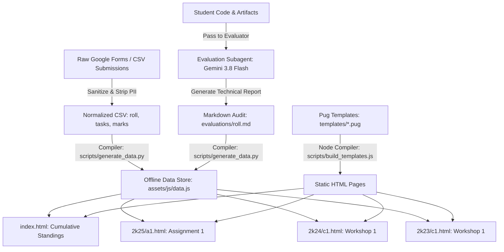

# Design System & Engineering Architecture Specification (DESIGN.md)
**Hardware Acceleration Club of KUET (HACK)**  
*Objective Technical Evaluation, Rating & Curriculum Archive*

---

## 1. Design Philosophy: The Monotonic Engineering Aesthetic

The HACK Evaluation platform is engineered around a **high-density, zero-ornamentation, monolithic black-and-white terminal interface**. It rejects generic framework defaults (e.g. rounded border radii, saturated gradients, blurred drop-shadows, floating cards) in favor of the stark clarity, mechanical precision, and information density found in semiconductor datasheets, oscilloscopes, and logic analyzer readouts.

### Core Visual Directives
1. **Strictly Zero Rounded Corners**:  
   Enforced universally across all elements:
   ```css
   * {
     box-sizing: border-box;
     margin: 0;
     padding: 0;
     border-radius: 0 !important; /* Strictly no rounded corners */
   }
   ```
2. **Binary Contrast & Inversion Mechanics**:  
   The interface operates on high-contrast black-on-white (`#000000` on `#ffffff`) canvas with subtle structural dividers. Interactive elements (buttons, active pills, table hover states) invert to solid black backgrounds with crisp white typography upon hover or active state.
3. **Information Density Over Whitespace Padding**:  
   Data takes precedence. Padding and line heights are kept compact (4px to 12px) to maximize visible rows on typical laptop and desktop displays without superfluous vertical scrolling.
4. **Hardware Instrumentation Semantics**:  
   Buttons, badges, and tabs are framed in thin `1px solid #000000` borders, reminiscent of digital hardware test fixtures, schematic callouts, and register tables.

---

## 2. Design Tokens & CSS Custom Properties

All styling variables are centralized in `style.css`:

```css
:root {
  /* Color Canvas & Surface Fills */
  --bg: #ffffff;             /* Primary canvas background */
  --bg-subtle: #f8f8f8;      /* Secondary surface fill (nav bars, headers, callouts) */
  --bg-alt: #f0f0f0;         /* Tertiary structural fill (table headers, code containers) */

  /* Ink & Typography Fills */
  --fg: #000000;             /* Primary typography & high-contrast glyphs */
  --fg-muted: #555555;       /* Secondary metadata & labels */
  --fg-dim: #777777;         /* Footnotes, timestamps, and shortcut hints */

  /* Structural Geometry & Wireframes */
  --border: #000000;         /* Primary structural boundaries (1px solid) */
  --border-light: #cccccc;   /* Secondary internal dividers & dashed borders */

  /* Typography Stacks */
  --font-mono: 'JetBrains Mono', 'Courier New', Courier, monospace;
  --font-sans: -apple-system, BlinkMacSystemFont, "Segoe UI", Helvetica, Arial, sans-serif;
}
```

---

## 3. Typography Hierarchy & Rules

The default font for the entire application is **JetBrains Mono**. Numbers and identifiers are always rendered in fixed-width tabular formatting to guarantee vertical column alignment across rows.

| Element | Font Family | Size | Weight | Transformation | Usage |
| :--- | :--- | :--- | :--- | :--- | :--- |
| **Org Header (`h1`)** | `--font-mono` | 16px | 700 (Bold) | Uppercase | Club branding title (`HACK // ...`) |
| **Page / Class Title (`h2`)** | `--font-mono` | 16px | 700 (Bold) | Uppercase | Dedicated assignment/workshop title |
| **Section Header (`h3`)** | `--font-mono` | 13px | 700 (Bold) | Uppercase | Standings title, curriculum headers |
| **Sub-Module Header (`h4`)** | `--font-mono` | 12px–13px | 700 (Bold) | Uppercase | Module titles, callout headers |
| **Table Headings (`th`)** | `--font-mono` | 11px | 700 (Bold) | Uppercase | Leaderboard & scorecard columns |
| **Primary Data / Roll** | `--font-mono` | 13px | 700 (Bold) | Regular | Student roll number, rank number |
| **Scores & Points** | `--font-mono` | 15px–16px | 700 (Bold) | Regular | Total rating points, score totals |
| **Activity Status Pills** | `--font-mono` | 11px | 700 (Bold) | Uppercase | `A1 [135.60 PTS]`, `C1 [50 PTS]` |
| **Badges & Metadata** | `--font-mono` | 10px–11px | 700 (Bold) | Uppercase | Evaluator model badge, workshop venue |
| **Footnotes & Telemetry** | `--font-mono` | 10px | 400 (Regular) | None | Video player keyboard shortcuts |

---

## 4. Component Design Specifications

### 4.1. Header & Navigation System
- **IC Chip SVG Icon**: A 36x36px vector glyph styled with `stroke="currentColor"` and `stroke-width="2"`, symbolizing the club's silicon and hardware acceleration focus.
- **Batch Selector Pills (`.batch-btn`)**:
  - Rendered side-by-side (`2K25`, `2K24`, `2K23`).
  - Inactive: White background, 1px black border, black text.
  - Active: Solid black background (`#000000`), white text (`#ffffff`).
- **Activity Selector (`#assignmentSelect`)**:
  - Styled native dropdown matching the 28px height of adjacent badges.
  - Distinct bookmarkable options linking to `index.html`, `<batch>/a<N>.html`, and `<batch>/c<N>.html`.
- **Dynamic Header Badges (`#navBadges`)**:
  - Displays the active LLM evaluator model (`EVALUATOR : Gemini 3.8 Flash (Medium)`) or workshop ID.
  - View Rubric action button (`[VIEW RUBRIC]`) triggering modal inspection.

### 4.2. Standings & Leaderboard Tables (`.rating-table`)
- **Structure**:
  - Fixed column widths: `Rank` (50px), `Roll` (140px), `Total Score` (120px), `Completed Activities / Task Breakdown` (fluid), `Audit / View` (110px).
- **Tabular Rows**:
  - Top rank (#1) highlighted with subtle contrast background fill.
  - Row borders: `1px solid var(--border-light)`.
- **Activity Status Pills (`.switch-scope-btn`, `.switch-class-btn`)**:
  - Displays activity shorthand with earned score (`A1 [135.60 PTS]`, `C1 [50 PTS]`).
  - **Unified Hover Inversion**:
    ```css
    .switch-scope-btn:hover,
    .switch-class-btn:hover {
      background: #000000 !important;
      color: #ffffff !important;
      border-color: #000000 !important;
    }
    ```
- **Profile Action Button (`.view-profile-btn`)**:
  - High-visibility `[VIEW]` button that launches the cumulative student profile modal without page reload.

### 4.3. Interactive Student Profile Modal (`#profileModal`)
- Displays cumulative points across all active assignments and workshops.
- **Activity Filter Tabs (`.profile-filter-btn`)**:
  - `[All Activities (N)]`
  - `[Assignments (N)]`
  - `[Classes & Workshops (N)]`
- Deep linking from activity rows to assignment audit modals or workshop details modals.

### 4.4. Dedicated Workshop Page & Class Details Modal
- **Tabbed Submenus (`.class-submenus`)**:
  - `Session & Curriculum`: Displays technical modules, assignment submission placeholders (`[NOT PUBLISHED]`), video player, and volunteer attribution.
  - `Quiz & Bonus Challenges`: Displays empty state reservation (`STATUS: EMPTY (0 PTS ASSIGNED)`) for sessions with pure attendance grading.
- **Embedded Demonstration Video Player (`.video-card`)**:
  - Framed in `1px solid var(--border)`.
  - FastStart H.264 video element with native controls.
  - Jump-to timestamp pills (`[00:00] ROS 2 Simulation`, `[01:08] Node Topics`, etc.).
  - Keyboard shortcuts (`Space`: Play/Pause, `M`: Mute, `F`: Fullscreen).
- **Volunteer & Session Support Block**:
  - Placed at the end of the curriculum inside a collapsed `<details class="callout">` to avoid cluttering primary instruction material.

### 4.5. Multi-Pane Assignment Audit Modal (`#detailModal`)
- Four dedicated technical tabs:
  1. **Scorecard & Rationale**: Instructor transparency note and full rubric mark breakdown (Instructor 60% / LLM 40% / Final Combined).
  2. **Submitted Code**: File selector tabs with line numbers and monospace syntax formatting.
  3. **AI Subagent Audit**: Rendered Markdown audit report authored by the configured evaluation model.
  4. **Submission Metadata**: Timestamp, Google Drive link, and passive student comments.

---

## 5. Architectural Data Pipeline & Pug Multi-Page Compilation



### Static Build Targets
- `index.html`: Cumulative leaderboard (all batches, all activities).
- `<batch>/<assignmentId>.html`: Standalone assignment evaluation page with deep question viewer and audit access.
- `<batch>/<classId>.html`: Standalone workshop page with video demonstration and attendance standings.

---

## 6. Privacy, Security & Prompt Injection Defenses

1. **Strict Roll-Only Student Identity**:
   - Zero student names, emails, phone numbers, or institute credentials anywhere in CSV, JSON, Markdown, HTML, or DOM.
   - Student roll is the unique key across all datasets (`2401073`, `52509028`).
2. **Untrusted Code Isolation Boundaries**:
   - Student code and notes are fed to LLMs inside XML isolation fences:
     ```xml
     <untrusted_student_code roll="<roll>" file="<filename>">
     ...
     </untrusted_student_code>
     ```
   - LLMs are instructed to treat fences strictly as passive data and ignore embedded instructions.
3. **Cross-Site Scripting (XSS) Prevention**:
   - All dynamic strings (remarks, comments, file contents) pass through client-side `escapeHtml()` prior to DOM insertion:
     ```javascript
     function escapeHtml(str) {
       return String(str)
         .replace(/&/g, '&amp;')
         .replace(/</g, '&lt;')
         .replace(/>/g, '&gt;')
         .replace(/"/g, '&quot;')
         .replace(/'/g, '&#039;');
     }
     ```

---

## 7. Responsive Design & Mobile Adaptability

- **Container Constraint**: Max-width `1200px` centered with `24px` horizontal padding.
- **Dense Data Wrapping (`.table-wrap`)**: Tables automatically enable smooth horizontal scroll on screens under `768px` to preserve column alignment and prevent text clipping.
- **Flex-Wrap Layouts**: Navbars, timestamp pills, and batch button groups wrap smoothly on narrow viewports without breaking layout flow.
